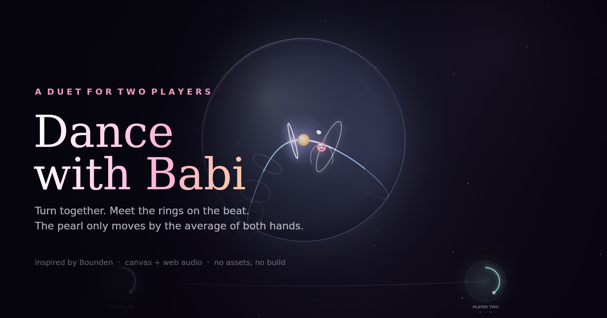
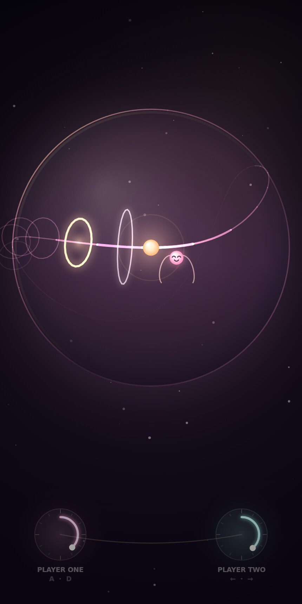
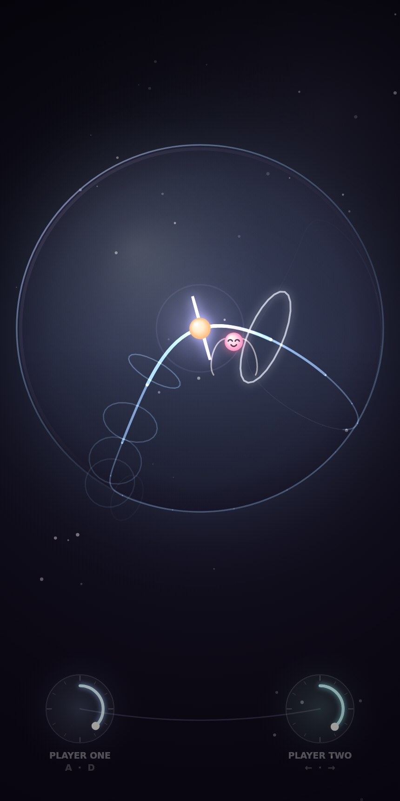
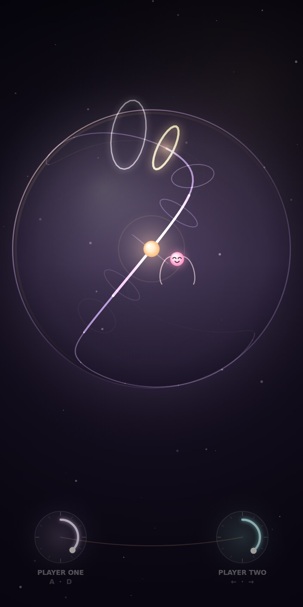

<p align="center">
  
</p>

<h1 align="center">Dance with Babi</h1>

<p align="center">
  <strong>یک بازی وب برای دو نفر، روی یک صفحه.</strong><br/>
  A two-player dancing game for one screen — playable on a phone, a tablet or a laptop.<br/>
  <a href="https://babakmoradvand87-commits.github.io/dance-with-babi/">▶ play it in the browser</a>
</p>

<p align="center">
  
  
  
  
</p>

---

## فارسی

**Dance with Babi** یک بازی رقص دونفره است که با الهام از بازی *Bounden* ساخته شده: دو بازیکن یک صفحه را
بین خودشان تقسیم می‌کنند، هر کدام یک «دایل» (دایرهٔ چرخشی) دارند و باید هم‌زمان و هم‌جهت بچرخانند تا مروارید
روی کرهٔ شیشه‌ای، مسیر طراحی‌شده را طی کند و درست روی ضربِ موسیقی از میان حلقه‌های طلایی بگذرد.

**قانون اصلی:** مروارید فقط با *میانگین* چرخش دو دایل حرکت می‌کند. یعنی هیچ‌کس نمی‌تواند تنهایی برقصد —
این کل لذتِ بازی است. اگر دو نفر خلاف هم بچرخند، روبانِ بین‌شان پاره می‌شود و کمبو می‌شکند.

| | |
|---|---|
| 🎮 **دو نفره روی یک صفحه** | موبایل: هر نفر یک دایل را با شست بچرخاند · لپ‌تاپ: نفر اول `A`/`D` و نفر دوم `←`/`→` |
| 🕺 **حالت تک‌نفره** | یک دایل در وسط صفحه؛ همان مکانیک، یک جفت دست |
| 🎵 **موسیقی زنده** | والس در لا مینور که در همان لحظه با Web Audio ساخته می‌شود — هیچ فایل صوتی‌ای در ریپو نیست |
| 💃 **سه رقص** | First Bow (۸۴ bpm) · Moonlit Spin (۹۶ bpm) · Babi's Finale (۱۰۸ bpm) |
| 🏅 **امتیاز و ستاره** | دقتِ ضرب، کمبو، بهترین رکورد و باز شدن رقص بعدی (در `localStorage`) |

نصب لازم نیست: فایل `index.html` را باز کنید (یا با یک سرور محلی سرو کنید) و تمام.

---

## How to play

1. **Take a dial each.** Two players share one device: player one owns the left dial, player two the right
   one. On a keyboard, player one uses <kbd>A</kbd>/<kbd>D</kbd> and player two <kbd>←</kbd>/<kbd>→</kbd>.
2. **Turn together.** The pearl only moves by the *average* of both dials, so nobody can carry the dance
   alone. Turn clockwise to roll forward.
3. **Meet the rings on the beat.** Every ring is one beat of the waltz. Pass it exactly when it sounds:
   *perfect*, *good*, *on the edge* — or early/late.
4. **Keep the ribbon.** Twist against each other and the ribbon between your dials frays and your combo
   snaps.

<br/>
<p align="center">
  
  
  
</p>

## The three dances

| dance | tempo | rings | what happens |
|---|---|---|---|
| **First Bow** | 84 bpm | 24 | a single breathing ribbon around the sphere — one ring per beat, nothing hidden |
| **Moonlit Spin** | 96 bpm | 30 | a figure eight: the choreography crosses itself, keep the count |
| **Babi's Finale** | 108 bpm | 36 | three petals at speed, the fastest waltz of the evening |

Finishing a dance with at least one star unlocks the next one.

## How it works

The whole game is four small files, one stylesheet and zero dependencies:

| file | what's inside |
|---|---|
| `src/paths.js` | the choreography. Each dance is a closed curve on the unit sphere — a breathing ribbon, a stereographic figure eight, a three-petal rose — re-sampled by **arc length** so that one beat always equals one equal step along the path. |
| `src/render.js` | the look. A 2D canvas is turned into a 3D-ish scene: the sphere is a glass ball, the choreography is a curve projected from the sphere surface, the rings are hoops perpendicular to the path's tangent, and the camera is rotated every frame so the pearl always sits at the front-centre — which is why the rings appear to sweep past you as you turn. |
| `src/audio.js` | the music. A generative waltz in A minor: pad, bass, harp arpeggio and a celesta melody, scheduled ahead of the audio clock, plus a generated hall reverb. All synthesised, no samples. |
| `src/game.js` | the rules. Judging, combo, the tangle between the two players, screens and persistence. |

A few notes on the design:

* **Timing** is measured against the audio clock (`AudioContext.currentTime`), not `requestAnimationFrame`,
  so the rings stay true to the music even if the frame rate dips. With no audio available it falls back to
  a `performance.now()` clock.
* **The count-in happens in negative song time.** The waltz starts six beats before the first ring so that
  both players can feel the tempo before anything is asked of them.
* **Difficulty is a speed, not a rule.** Holding both dials at ~1.35 rad/s lands every ring perfectly, so
  the game teaches a *tempo* rather than a sequence of button presses.
* **No failure state.** You cannot lose a dance; you can only leave with fewer stars. The ribbon snaps and
  the combo resets, that's all.

## Run it locally

```bash
git clone https://github.com/babakmoradvand87-commits/dance-with-babi.git
cd dance-with-babi
python3 -m http.server 8000   # or just double-click index.html
```

`index.html` is a **single self-contained file** — the CSS and the JavaScript are inlined, so the game
works from the filesystem, from a USB stick, or inside a sandboxed iframe with no network at all.
It is generated from the sources:

```
src/            editable sources (style.css + four scripts)
tools/template.html   the HTML shell
tools/build.py        welds src/ into index.html
```

After editing anything in `src/`, rebuild:

```bash
python3 tools/build.py      # writes index.html (~99 KB)
```

No bundler, no npm, no dependencies. Published with GitHub Pages straight from the `main` branch.

## Credits

* Inspired by **[Bounden](https://apps.apple.com/us/app/bounden/id850456491)** (Adriaan de Jongh / Game Oven,
  choreography by the Dutch National Ballet) — a game about two people holding one phone. This is an
  original, non-commercial tribute: all code, choreography, art direction and music here are written from
  scratch for the browser.
* Built with the Canvas 2D API and the Web Audio API. No libraries, no image files, no audio files.

## License

MIT — see [LICENSE](LICENSE).

<p align="center"><sub>made for two people and one screen · با دو دست و یک صفحه</sub></p>
